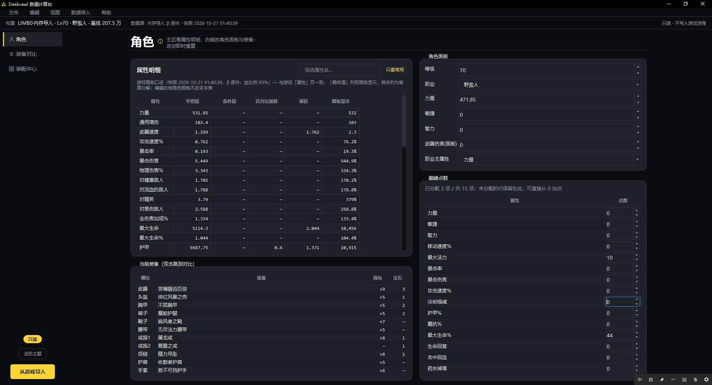
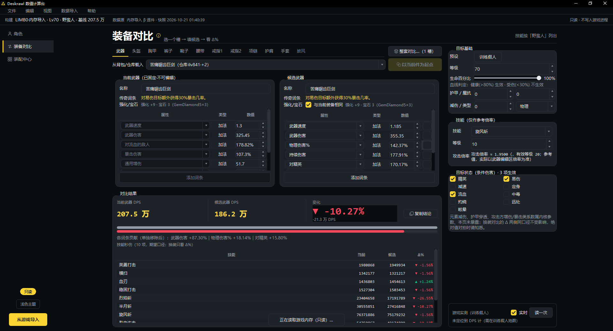
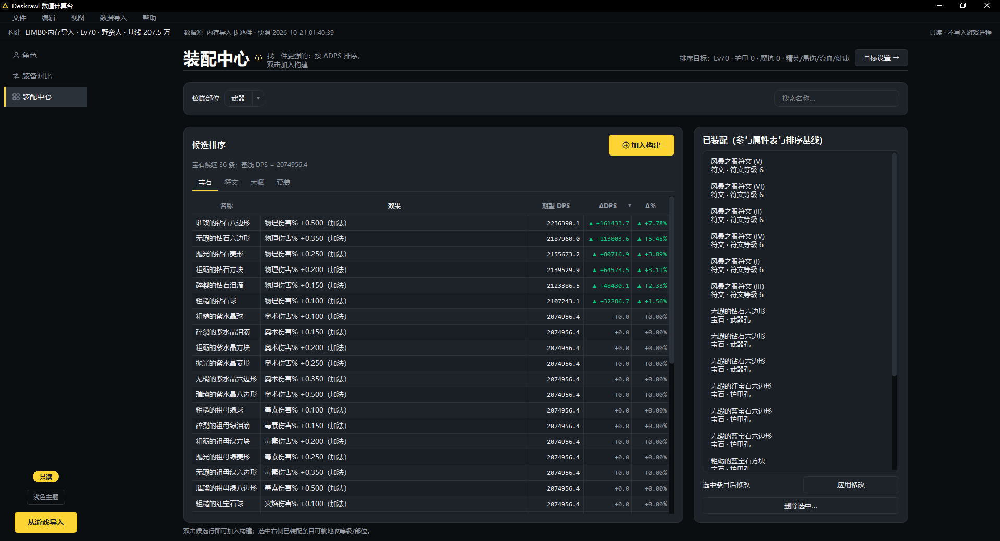

# Deskrawl-Reverse — Deskrawl 数值逆向与计算工具

> **一句话**：对单机/挂机暗黑类游戏 **Deskrawl: Idle ARPG**（Unity 6000.3.6f1 / IL2CPP / GUPS.Obfuscator 混淆）
> 做的**只读**数值逆向——已还原完整伤害公式、1333 条静态数值（SO 实例）、装备词条生成规则与存档加解密，
> 并据此产出三个可运行工具：**数值计算内核** `deskrawl_calc`、**桌面 GUI** `deskrawl_gui`、**内存快照 CLI** `memdump`。
>
> **状态**：逆向已闭环，数据层 1333 条 0 残留；当前开发方向为 GUI 与角色数据接入。
>
> ⚠️ **本仓库全程只读游戏文件，任何情况下不得修改游戏安装目录内的文件**。代码以 MIT 许可开源（见 [许可](#许可)），
> 仅供学习研究；仓库不含游戏本体、也不含大体积逆向产物与个人账号数据（见[准备 schema 与第三方工具](#准备-schema-与第三方工具)）。


---

## 功能特性

| 工具 | 说明 | 依赖 |
|---|---|---|
| `deskrawl_calc` | 计算内核：三层属性聚合 + 伤害乘区 + 装备对比，纯函数库 | 零第三方依赖 |
| `deskrawl_gui` | 桌面 GUI（PySide6）：角色面板 → 装备对比 → 装配中心，支持从游戏内存只读导入联机角色 | PySide6 |
| `deskrawl_gui.memdump` | 内存快照 CLI：游戏运行中导出角色数值（人类可读 / JSON） | 同 GUI |
| `tools/scripts/` | 逆向工具链：SO 批量导出、存档解密、反汇编、补丁后地址体检 | UnityPy / capstone / cryptography |

核心数值结论（均有指令级/字节级证据）：

```
Final(stat) = (Base + ΣFlat) × (1 + ΣPercentAdd) × Π(1 + PercentMult)   ← 三层聚合

伤害 = 攻强 × [1 + 元素% + 全伤害%]          ← 乘区A（同池加算）
           × (1 + 暴伤)                      ← 乘区B（暴击时，独立）
           × (1 + Σ10项条件伤害)             ← 乘区C（同池加算）
           × 1.3 × Random(0.9,1.1)           ← 易伤固定 + 命中浮动
           × Π(1 − 护甲/元素/全局减伤)        ← 减伤层（乘法）
```

- **同池加算陷阱**：物理伤害% 与全伤害加成% 是同一个池；10 项条件伤害同池。
- **封顶**（1.0.2b 实证）：暴击率/闪避/蓝耗缩减 ≤ 0.85；CDR ≤ 0.80；减伤类 ≤ 0.90。
- 职业主属性进攻击伤害：`(武器伤害 + Final(20) + Final(3)) × (1 + Final(主属性)/100)`。
---

## 界面预览

- **角色页：主区属性明细（三层聚合分解 / 游戏面板口径）+ 11 槽当前装备，右侧角色面板与巅峰点数**
 

- **装备对比：结论三格（当前 / 候选 / 变化）+ 结论条 + 技能表；下方当前/候选双编辑器，右栏目标、参考技能与实测**
 

- **装配中心：类别标签条 + 候选 ΔDPS 排序（涨跌着色）+ 右侧已装配清单**


> 视觉规范（色板/字体/布局/交互/响应式）见 [GUI 设计规范](docs/plan/GUI设计规范.md)。


## 目录结构

```
Deskrawl-Reverse/
├─ README.md                  ← 本文（项目概览与快速上手）
├─ AGENTS.md                  ← AI 代理操作规范与项目上下文
├─ LICENSE                    ← MIT 许可
├─ 启动GUI.bat                ← GUI 一键启动（首跑自动建 venv 装依赖，参数透传）
├─ requirements-gui.txt       ← GUI 依赖清单（PySide6>=6.6）
├─ requirements-build.txt     ← 打包依赖（PyInstaller>=6.14，仅构建期需要）
├─ packaging/                 ← 便携版打包（入口 launcher / spec / 构建脚本 / 打包脚本）
│
├─ docs/                      ← 数值设计文档集
│   ├─ 00-索引.md             ← 文档入口（分类地图与按需阅读路径）
│   ├─ 01…09-*.md             ← 机制与结构篇(01–05) + 实测与工具篇(06–09)，编号即阅读顺序
│   ├─ agents/                ← issue-tracker 与 domain 文档约定
│   ├─ plan/                  ← 现行计划/清单/进度档（含补丁回归清单；已完结证词在 archive/）
│   └─ reports/               ← 脚本产出的报告（勿手改）
│
├─ tools/
│   ├─ deskrawl_calc/         ← ★ 计算内核（纯 Python，零依赖，可独立作库）
│   │   ├─ stattype.py        StatType 枚举(67 项)与分组表
│   │   ├─ engine.py          三层聚合 + 伤害乘区 + 装备对比
│   │   ├─ gamedata.py        数据层（宝石/符文/天赋/传奇特效/巅峰/词条 Roll）
│   │   ├─ effects.py         传奇特效消费逻辑
│   │   └─ cli.py             selftest（26 项断言）+ 换武器对比示例
│   │
│   ├─ deskrawl_gui/          ← ★ 桌面 GUI（只依赖 PySide6 + deskrawl_calc）
│   │   ├─ app.py             主窗口装配（顶部导航 + 上下文条 + 三页堆栈）
│   │   ├─ __main__.py        三模式：默认 GUI / --selftest [组] / --smoke [组]
│   │   ├─ memdump.py         内存快照 CLI
│   │   ├─ undo.py            撤销/重做（整档快照比对，一个栈管全应用）
│   │   ├─ selftest.py        GUI 自检（87 项，内核 26 项为通过门槛；按组运行见下）
│   │   ├─ selftest_legendary.py / selftest_skillmods.py / selftest_effects.py
│   │   │                     文案组 / 天赋修正组 / 特效口径组（纯数据，从主自检拆出）
│   │   ├─ selftest_fixture.py + selftest_equipment.py
│   │   │                     导入夹具（α/β 闭环、面板锚点）/ 装备链路+镜像+技能表
│   │   ├─ selftest_robustness.py   鲁棒性组（空候选/缓存/日志/整套对比/构建库/主题）
│   │   ├─ selftest_gui_behavior.py + selftest_gui_pages.py
│   │   │                     --smoke 的按页交互检查与结构/布局契约
│   │   ├─ core/              服务层纯函数 + 内存导入链（profile/calc_service/memory_*）
│   │   │                     + compare_multi（整套对比）/ build_library / theme / import_worker
│   │   ├─ widgets/           UI 组件（22 个模块；含 navigation 顶栏 / segmented 标签条 / card 容器、
│   │   │                     help_panel / build_library / multi_compare、collapsible、delta_bar）
│   │   └─ resources/         主题 QSS（暗/浅一套源）+ 线性图标（icons/）
│   │
│   ├─ scripts/               ← 逆向脚本（86 个 .py；重依赖，仅重建数据时需要）
│   │   ├─ paths.py           统一路径解析（仓库可任意移动）
│   │   ├─ schema.py / decode.py   Unity 二进制反序列化器
│   │   ├─ dump_all2.py / dump_effects.py   SO 与特效批量导出
│   │   ├─ decrypt_save.py / read_save.py   存档解密与解析
│   │   ├─ disasm.py / disasm2.py / xref.py 反汇编与交叉引用
│   │   ├─ rva_audit.py / build_aliases.py / patch_regression.py  补丁后地址工具链
│   │   └─ …                  其余为一次性探针（probe/scan/exp_*）
│   │
│   └─ thirdparty/            ← 第三方工具（Il2CppDumper；不入库，见「准备 schema 与第三方工具」）
│
└─ data/
    ├─ so_dump/               ← ★ 25 个 JSON（1333 条 SO 实例，全部静态数值的事实源）
    ├─ loc/                   ← 简中本地化表（abilities / equipments / ui）
    ├─ builds/                ← GUI 构建存档（仅示例 demo-hunter.json 入库）
    └─ schema/                ← 仓库只带 aliases.json + rva_audit*.json；
                                dump.cs / script.json / stringliteral.json 须自行生成（见下）
```

> **仓库不含**（`.gitignore` 排除，需本地生成）：`data/schema/` 三个 Il2CppDumper 大文件（约 121 MB）、
> `tools/thirdparty/` 第三方二进制（约 43 MB）、`data/save_decrypted.json`（本机账号存档）与个人构建。
> 这样仓库本身只有几 MB，clone 秒级。

## 环境依赖

| 用途 | 要求 |
|---|---|
| 计算内核 / 地址体检 | Python 3.10+，**零第三方依赖**（系统 Python 即可） |
| 桌面 GUI / 内存快照 | 同上 + `PySide6>=6.6`（`requirements-gui.txt`，独立 venv 安装） |
| 便携版打包 | 同上 + `PyInstaller>=6.14`（`requirements-build.txt`，仅构建期需要） |
| 逆向脚本（tools/scripts/） | 同上 + `UnityPy`、`capstone`；存档解密另需 `cryptography` 或 `pycryptodome`（任一） |
| 内存快照 CLI | Windows，64 位 Python，游戏运行中，可能需管理员权限 |

游戏目录由环境变量 `DESKRAWL_GAME` 定位（默认 `d:\steam\steamapps\common\Deskrawl`），换机器只需设它。

## 准备 schema 与第三方工具

`data/schema/` 的三个大文件与 `tools/thirdparty/` **不随仓库分发**，首次使用前需本地生成/获取。
只影响地址工具链（`rva_audit.py` / `build_aliases.py`）与逆向脚本；**计算内核与 GUI 不依赖它们**，可直接跑。

1. 下载 [Il2CppDumper](https://github.com/Perfare/Il2CppDumper/releases)（本仓用 v39），解压到 `tools/thirdparty/Il2CppDumper/`。
2. 对游戏的 `GameAssembly.dll` + `Deskrawl_Data/il2cpp_data/Metadata/global-metadata.dat` 运行导出。
3. 只保留 `dump.cs` / `script.json` / `stringliteral.json` 三个文件，放入 `data/schema/`。

```powershell
$env:DESKRAWL_GAME = 'd:\steam\steamapps\common\Deskrawl'   # 换机器只需设它
cd D:\workspace\Deskrawl-Reverse\tools\scripts
python rva_audit.py --check --falsify    # 体检可用性验证：退码 0 = 无失效/待确认
```

- 生成的 `dump.cs` / `script.json` 合计约 121 MB，是游戏的逆向产物，故不入库；各人按自己的游戏版本生成即可。
- 第三方工具同理，请遵守其各自许可。
- `data/save_decrypted.json`（本机账号存档，含 ProfileId/玩家名）由 `python decrypt_save.py` 本地生成，**不入库**。
- 个人构建存 `data/builds/` 也不入库（仅示例 `demo-hunter.json` 例外）。

## 快速开始

### 1. 计算内核（约 1 分钟，零依赖）

```powershell
cd D:\workspace\Deskrawl-Reverse\tools
python -m deskrawl_calc.cli selftest   # 26 项公式断言自检；CI 友好，非 0 退出码 = 失败
python -m deskrawl_calc.cli            # 自检 + 「换武器 DPS 对比」示例
```

### 2. 桌面 GUI（约 3 分钟）

方式一：双击根目录 `启动GUI.bat`（首跑自动建 `.venv-gui` 并装依赖，参数透传，如 `启动GUI.bat --selftest`）。

方式二：手动建 venv：

```powershell
cd D:\workspace\Deskrawl-Reverse
python -m venv .venv-gui
.\.venv-gui\Scripts\python.exe -m pip install -r requirements-gui.txt
cd tools
..\.venv-gui\Scripts\python.exe -m deskrawl_gui              # 启动主窗口（暗色主题）
..\.venv-gui\Scripts\python.exe -m deskrawl_gui --selftest   # 自检：内核 26 项 + GUI 87 项
..\.venv-gui\Scripts\python.exe -m deskrawl_gui --selftest import panel   # 只跑指定组（组名见下表）
..\.venv-gui\Scripts\python.exe -m deskrawl_gui --smoke      # 无显示环境骨架冒烟（建窗即退）
..\.venv-gui\Scripts\python.exe -m deskrawl_gui --smoke behavior   # 只跑交互检查
```

`--selftest` 不带组名即全量（CI/打包门禁走这条）：先过内核 26 项门槛，再按组跑 GUI 断言。
按组运行会跳过内核门槛，只跑所列组——改一个控件时不必等全量输出：

| 组名 | 覆盖 |
|---|---|
| `engine` | 引擎对拍 / 输入敏感性 / 装备名解析 |
| `rank` | 候选排序与基线对拍 |
| `build` | 构建存取往返 / 会话状态 / 数值格式 / 构建库扫描 |
| `import` | 内存导入夹具（α/β 闭环、面板锚点、装备链路、镜像、技能表） |
| `panel` | 游戏面板口径复算（23 行锚点） |
| `legendary` | 传奇特效建模与接线 |
| `talents` | 天赋修正（按技能 / 条件 / 换算） |
| `robust` | 空候选 / 缓存 / 导出 / 日志 / 整套对比 |
| `ui` | 表格模型纯逻辑 + 属性元数据（输入单位/显示格式）+ 主题令牌 |

`--smoke` 同款支持 `structure`（菜单与结构锚点）/ `behavior`（交互）/ `session`（会话持久化）/
`qss`（样式选择器对账）。

### 3. 从游戏内存导入角色（可选，游戏需运行中）

GUI 右上「从游戏导入」按钮（或菜单「数据导入」）：只读快照联机角色（装备逐件词条、面板、背包武器），
导入后自动翻译装备简中名并保留你的口径设置。命令行快照：

```powershell
cd D:\workspace\Deskrawl-Reverse\tools
..\.venv-gui\Scripts\python.exe -m deskrawl_gui.memdump --json   # 结构化快照
```

> 退出码：0 成功 / 2 环境错误 / 3 数据校验失败。整条内存导入链只允许
> `OpenProcess(READ)` + `ReadProcessMemory`，无任何写操作（见 [AGENTS.md](AGENTS.md) 验收条款）。

### 4. 便携版（免装 Python，解压即用）

给不想装 Python 的机器用。一条命令构建出便携文件夹（exe + `_internal/` + `data/`）与 zip：

```powershell
cd D:\workspace\Deskrawl-Reverse
.\packaging\build_portable.ps1     # 产物：dist\Deskrawl计算台\ 与同目录 zip（附 SHA256）
```

解压后双击 `Deskrawl计算台.exe` 即开 GUI；同一个 exe 还内置命令行入口：

> **你的会话与个人构建存在** `%LOCALAPPDATA%\Deskrawl\data`（不是 exe 旁边）：重建便携包、覆盖安装、
> 换解压目录都不会丢。首次运行会把旧版留在 exe 同级 `data\` 的会话/构建一次性搬过来。

```powershell
.\Deskrawl计算台.exe --selftest       # 内核 26 项 + GUI 87 项自检（自动接回控制台输出）
.\Deskrawl计算台.exe --smoke          # 无显示环境骨架冒烟
.\Deskrawl计算台.exe memdump --json   # 内存快照 CLI（需游戏运行中）
```

推 `v*` tag 会在 GitHub Actions 自动构建并挂到 Release（`.github/workflows/build-portable.yml`），
且以「冻结态自检」为发布门禁。随包数据是白名单（`so_dump` / `loc` / 示例构建），不含个人数据与逆向产物。

## 使用说明

### 计算内核

作为库使用（自动定位 `data/so_dump`）：

```python
from deskrawl_calc import GameData, StatSheet, Modifier, Weapon, Target, compare_weapons, StatType

gd = GameData()
sheet = StatSheet()
sheet.add_mods(gd.gem_modifiers('GemAmethyst3', equip_category=2))    # 宝石（按镶嵌部位 0/1/2）
sheet.add_mods(gd.rune_modifiers('HunterSetRune1_4', rune_level=3))   # 符文
sheet.add_mods(gd.talent_modifiers('HunterTalent19', points=5))       # 天赋
sheet.add_mods(gd.equipment_effect_modifiers(4796))                   # 传奇特效（by pathID）
sheet.add_mods(gd.paragon_modifiers({4: 50}))                         # 巅峰

print(gd.ability_attack_scaling('FireElementalMeteor', 10))           # 技能倍率
print(gd.affix_range(4, 70, 3))                                       # 词条 Roll 区间

r = compare_weapons(sheet, old_weapon, new_weapon,
                    target=Target(level=70, elite=True, vulnerable=True))
print(f'{r["delta_pct"]:+.2f}%')
```

> so_dump JSON 中的数值可能带 `Obscured*`/`LeveledFloat` 包装，处理时必须经内核的
> `unwrap()`，不能直接当 float 用。

### 桌面 GUI

主窗口三页（顶部导航切换，样式按 Binance 设计语言重绘；见 [GUI 设计规范](docs/plan/GUI设计规范.md)）：

| 页面 | 功能 |
|---|---|
| **角色** | 手动录入/编辑角色面板，属性明细（三层聚合分解 + 面板口径复算），构建存取 `data/builds/*.json` |
| **装备对比** | 当前件（游戏事实）只读 vs 候选任意槽；候选可勾「与当前装备相同（强化/宝石）」；武器孔位宝石按侧计入 |
| **装配中心** | 宝石/符文/天赋/技能候选按收益排序（已优化至约 12 ms），支持搜索过滤 |

其他入口与能力：

- **整套对比**（对比页工具条）：把已填候选的多个槽一起换掉，给总 Δ 与逐槽边际——逐槽 Δ 之间
  不能相加（乘区交互），所以合计数单独成窗，不与单槽结论混在一屏；
- **构建库**（`文件 → 构建库…`，Ctrl+Shift+O）：一屏列出 `data/builds/*.json` 的名称/等级/职业/
  DPS/备注，双击载入，备注写回构建文件本身；损坏的文件单独标记，不影响整库打开；
- **撤销/重做**（Ctrl+Z / Ctrl+Shift+Z）：面板数值、词条增删、装配增删、目标设置都进栈，
  切槽这类视图动作不占步；换数据源（导入/加载构建）不入栈；
- **帮助面板**（F1）：操作速查 / 术语表 / 口径说明 / 数据来源分节，可检索、正文可整段复制；
- **主题**（`视图 → 主题` 或顶栏开关）：深色/浅色一套 QSS 源 + 色值表，选择随会话持久化；
- 数据导入走后台线程（读内存期间窗口不假死），保留用户口径（目标/参考技能/伤害类型/开关记忆）；
- 窗口几何、当前页、分栏宽度、主题与完整 profile 自动持久化（`data/session_state.json`，
  原子写，损坏自动回落）。

### 游戏更新后（补丁回归）

一条命令串行跑完指纹校验 → 地址体检 → 别名校验 → 自检 →（游戏运行中）实机验证：

```powershell
cd D:\workspace\Deskrawl-Reverse\tools\scripts
python patch_regression.py --live
```

详见 `docs/plan/补丁回归清单.md`；地址体检/语义别名的单独用法见 [AGENTS.md](AGENTS.md) 常用命令。

## 数据与置信度

| 类型 | 来源 |
|---|---|
| 指令级证据 | `GameAssembly.dll` 反汇编（capstone / REA-Ghidra） |
| 符号与结构 | Il2CppDumper(v39) 还原的 `data/schema/dump.cs` / `script.json` |
| 实测数值 | 自建 schema 驱动反序列化器导出的 1333 条 SO 实例（字节级精确，0 残留） |

标注约定（全仓库统一）：`✅` 指令/字节级证据 · `🔶` 高置信推断 · `⚠️` 待确认。
引用数值时请沿用此标注，不要把 🔶 或暂缓写成定论。

## 文档导航

- **新参与者**：`docs/00-索引.md`（分类地图与按需阅读路径）→ 机制篇 01–05 → 公式核心 `docs/04`。
- **补丁维护者**：`docs/plan/补丁回归清单.md`（五步回归）+ `docs/08` §11 硬结论、§12 重锚定结果。
- **AI 代理**：先读 [AGENTS.md](AGENTS.md)（项目上下文、硬约束、编码约定、交工前三检查）。

## 贡献指南

1. **改公式/数据层后必须跑自检**：`deskrawl_calc.cli selftest`（26 项）与 `deskrawl_gui --selftest`（87 项）；
   GUI 的 DPS 锚点（`selftest.py` 的 `ANCHORS`）与内核一起冻结，改动公式需同步更新。
2. **涉及地址的改动**（补丁后重锚定、新增反汇编结论）交工前跑三件事：
   `rva_audit.py --check --falsify`、`build_aliases.py --check`、`deskrawl_gui --selftest`。
3. **编码约定**：函数级注释解释「为什么」（1–3 行）；单文件有效代码 ≤ 800 行（棘轮规则，只降不升）；
   新功能优先复用现有模块。详见 [AGENTS.md](AGENTS.md) 编码约定。
4. **硬约束**：GUI 包不得 import `tools/scripts`；不得修改游戏安装目录内的文件。

## 许可

本项目代码以 [MIT 许可](LICENSE) 开源。

**免责声明**：本仓库是对游戏《Deskrawl: Idle ARPG》的**只读**研究性逆向，不含游戏本体、游戏资源与游戏代码本体；
`data/so_dump/`、`docs/` 中的数值与结论是逆向分析的产物，版权归原游戏权利方所有。使用者应自行确保符合当地法律
与游戏的服务条款，仅用于学习研究，不得用于商业用途或二次分发游戏资产。
